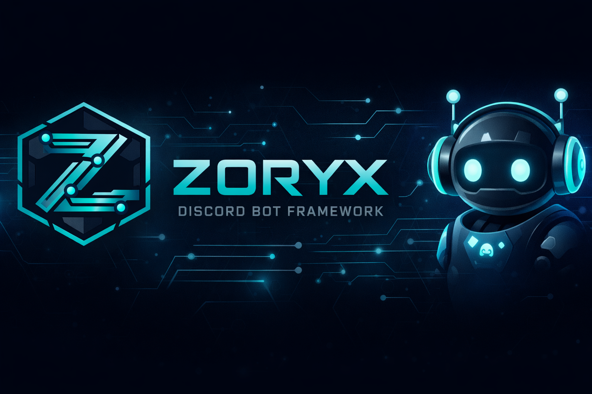

<div align="center">



# ZDBF V2: Zoryx Discord Bot Framework

**A free, open-source Discord bot written in Python that you can run as it is or build on.**<br>
Server backups, no-code automations, a cron scheduler, support tickets, diagnostics, an extension
marketplace and a web dashboard, with every message drawn as a Components V2 layout.

[](https://www.python.org/downloads/)
[](https://github.com/Rapptz/discord.py)
[](LICENSE)
[](CHANGELOG.md)

[Quick start](#quick-start) ·
[Features](#features) ·
[Commands](#commands) ·
[Dashboard](#web-dashboard) ·
[Documentation](docs/README.md) ·
[Build an extension](docs/dev/extensions.md)

</div>

---

## What is ZDBF?

ZDBF (Zoryx Discord Bot Framework) is a self-hosted Discord bot for server owners and a framework
for Python developers. Download it, add your bot token and start it: you get a working bot with
backup and restore, welcome messages, role panels, tickets, levels, a word filter, scheduled
messages and more, all set up from Discord with buttons and menus. Nothing has to be programmed.

When you want something it does not do, write an extension: a Python file in `extensions/` that
reloads the moment you save it. Extensions get the same building blocks as the built-in features:
cards and menus, storage, event hooks, the scheduler and their own page in the web dashboard.

ZDBF V2 is a complete rewrite of the [original framework](https://github.com/TheHolyOneZ/discord-bot-framework)
and runs on Python 3.12, 3.13 and 3.14 with discord.py 2.7.

## Why ZDBF

- **Ready on first start.** One required value (`DISCORD_TOKEN`), a commented default config
  written for you, owners detected from your Discord application.
- **Set up from Discord.** Automations, backups, schedules and settings use buttons, menus and
  forms. Every command works as `/slash` and with a prefix (`!`).
- **Hard to break.** The database recovers itself from a damaged file. A broken extension edit is
  rolled back and the old version keeps running. A failing automation or hook is switched off
  before it can flood your server. Unexpected errors show the user a short code and send you the
  full traceback.
- **Safe to restore.** Backups carry a checksum, and every restore can be previewed as a dry run
  before anything changes.
- **A web dashboard on ordinary hosting.** Upload PHP files to any web host. The bot connects out,
  so your bot machine needs no open port. Dangerous actions are off by default and wait for your
  approval in a Discord DM.
- **Easy to extend.** Hot reload, dependency checks, a Components V2 UI kit, storage and migrations,
  event hooks with circuit breakers, and dashboard panels written in plain Python.
- **Clean to look at.** Restrained cards with status dots, no emoji clutter, pagination on
  anything that could overflow Discord's limits.
- **Free.** Apache-2.0 licensed. Run it, change it, ship it.

## Features

| Area | What you get |
|---|---|
| [Commands and help](#commands-and-help) | Grouped slash commands that also work with a prefix, an interactive `/help` with search and per-command details, V1 names kept as aliases. |
| [Server settings](#server-settings) | Prefix per server, @mention prefix, role requirements per command or group. |
| [Automations](#automations) | 11 ready templates (welcome, role panels, tickets, XP, word filter...) and custom automations with triggers, up to 15 actions and conditions. |
| [Backup and restore](#backup-and-restore) | Full server snapshots, compare, dry-run preview, selective restore, scheduled backups. |
| [Scheduler](#scheduler) | Cron tasks in your time zone that post messages, fire events or write logs. |
| [Diagnostics and alerts](#diagnostics-and-alerts) | Health checks, event-loop lag, error tracking, an integrity check and alerts sent to a channel per system. |
| [Extensions](#extensions) | Drop-in Python files with hot reload, rollback, dependency and conflict checks. |
| [ZSync Marketplace](#zsync-marketplace) | Browse, safety-scan, install and update community extensions from Discord. |
| [Database](#database-and-storage) | One SQLite file with atomic writes, automatic recovery and rolling backups. |
| [Sharding and clusters](#sharding-and-clusters) | Shard monitor and multi-process clusters over signed IPC. |
| [Web dashboard](#web-dashboard) | Control the bot from a browser: chat as the bot, run commands, edit files, manage servers and more. |

### Commands and help

- Every command is a hybrid: it works as `/slash` and with the prefix (default `!`, case-insensitive).
- Commands are grouped (`/backup create`, `/hooks list`), so the framework uses only 15 of the 100
  top-level slash commands Discord allows (17 with the optional dashboard and cluster modules).
  If extensions push the total over 100, the extra commands keep working with the prefix.
- `/help` is an interactive guide: one card per category, a **Details** page for every command
  (usage, options, defaults, who can use it, aliases, cooldown) and a **Search** button. It only
  lists what the member can run. `/help <command>` jumps straight to one, and a typo suggests the
  closest match.
- `/about`, `/ping` (gateway, API and database latency) and `/stats` (uptime, members, command and
  error counts, memory, shards, most used commands).
- Mentioning the bot shows its prefix and where to start.
- A default cooldown for commands without one (bot owners are exempt).
- A rotating status with placeholders such as `{guilds}` and `{users}`.

### Server settings

- `/settings prefix` sets a prefix for the server, `/settings mentionprefix` allows or blocks
  `@Bot <command>`.
- `/settings permissions` requires roles for a single command or a whole group. Server owners and
  administrators are never restricted.
- `/settings view` shows everything that is set.

### Automations

Built with a visual builder (`/hooks create`), managed with `/hooks list`, `info`, `toggle` and `history`.

| Template | What it does |
|---|---|
| Welcome | Greets new members with a card or text, gives an auto role, optional DM. |
| Goodbye | Posts a farewell when a member leaves. |
| Button roles | A panel of buttons that toggle roles, optionally one role at a time. Survives restarts. |
| Reaction roles | Emoji-to-role mapping on any message, optional removal on un-react. |
| Word filter | Deletes, warns, times out or kicks on banned words, with ignored roles and a log channel. |
| XP and levels | XP per message, level-up messages, reward roles, `/hooks rank` and `/hooks leaderboard`. |
| Recurring announcement | Posts a message every N hours. |
| Support tickets | An "Open ticket" button that creates a private channel, with transcripts saved on close. |
| Voice activity log | Logs voice joins, leaves, moves and mutes. |
| Join-to-create voice | Joining a hub channel creates a personal voice channel. |
| Webhook bridge | Forwards messages and joins to an external webhook (Discord, Zapier, Make). |

**Custom automations** combine one trigger with up to 15 actions and any number of conditions:

- **Triggers:** member joins or leaves, a message (any, contains, exact, starts with, regex), a
  reaction, joining a voice channel, or a schedule.
- **Actions:** send a message or card, DM, add or remove a role, time out, call a webhook, create a
  role, wait, or run another automation.
- **Conditions** (AND or OR): roles, role position, channels, time range, day of week, account
  age, member age, chance, not a bot, message content, message count and custom variables.
- **Placeholders** such as `{user}`, `{guild_name}`, `{member_count}`, `{date}`, `{random:1-10}`
  and `{math:...}`.
- Cooldowns per user or per server, a run history, and an automatic switch-off with an alert after
  10 failures in a row.

Guide: [docs/guide/automations.md](docs/guide/automations.md).

### Backup and restore

For server administrators.

- `/backup create` captures roles, categories, channels (text, voice, forum with tags, permission
  overwrites, slowmode), emojis, stickers, server settings, icon and banner, member roles and the
  bot's own settings for the server.
- Backups are compressed and checksummed (`/backup verify`).
- `/backup restore` lets you pick what to restore, preview every change as a dry run, then watch
  progress live and get a report.
- `/backup diff` compares a backup with another one or with the server as it is now.
- Pin backups to protect them, add notes, schedule automatic backups and see who did what with
  `/backup audit`.

Guide: [docs/guide/backups.md](docs/guide/backups.md).

### Scheduler

- `/schedule create` takes a standard cron expression (`0 9 * * mon-fri`), names, or a macro such
  as `@daily`, in any time zone (`Europe/Berlin`, `America/New_York`...).
- A task posts a message or card, fires an event for extensions, or writes a log line. It can stop
  after a set number of runs.
- `/schedule preview` explains an expression in plain words and lists its next runs.

Guide: [docs/guide/scheduler.md](docs/guide/scheduler.md).

### Diagnostics and alerts

For the bot owner.

- `/diag overview`: health (healthy, degraded or critical), event-loop lag, error rate, latency and
  memory, checked every 5 minutes. `/diag history` shows trends, `/diag errors` recent failures.
- `/fw integrity` checks configuration, the database, folders, extensions, intents, the slash
  command budget, latency and disk space in one go.
- `/fw alerts` sends alerts of each system (errors, backups, extensions, shards, marketplace...)
  to the channel you choose.

Guide: [docs/guide/operations.md](docs/guide/operations.md).

### Extensions

- Python files in `extensions/` load on start and reload when you save them. A broken edit is
  rolled back and the working version keeps running.
- `/ext list`, `load`, `unload`, `reload` and `info` manage them without a restart.
- Extensions declare versions, dependencies and conflicts, which are checked before they load.
  `/plugins` shows the dependency tree and any problems.
- Extensions written for V1 still run.

Write your own: [docs/dev/extensions.md](docs/dev/extensions.md).

### ZSync Marketplace

- `/marketplace` browses community extensions from the [ZSync Marketplace](https://zsync.eu/extension/).
- Before anything installs, the bot shows a safety scan: imports, risky calls such as `subprocess`
  or `socket`, the entry point, and the Python packages the extension still needs.
- **Install and load** installs those packages and loads the extension in one step (bot owner only).
- `/marketplace updates` finds newer versions, `/marketplace uninstall` removes one.

Guide: [docs/guide/marketplace.md](docs/guide/marketplace.md).

### Database and storage

- One SQLite file (`data/zdbf.db`) in WAL mode with atomic writes.
- Checked on every start: a damaged file is moved aside and the newest healthy backup is restored
  automatically.
- Rolling backups (7 kept by default) and one before every migration.
- Hourly maintenance: expired caches, old logs, database checkpoint and optimise.

### Sharding and clusters

- Automatic sharding, or manual with `SHARD_COUNT` and `SHARD_IDS`.
- `/shard monitor`, `health` and `details` show latency, uptime, reconnects and event throughput
  per shard, with alerts on failure and recovery.
- Optional clusters: several processes or machines talk over IPC where every frame is signed
  (HMAC-SHA256) and checked for age and replays.

### Web dashboard

<p>
The <strong>ZDBF Dashboard</strong> is a web control panel you upload to any PHP 8.1+ host.
It is off by default; turn it on with <code>[modules] dashboard = true</code>.
</p>

- **Install in minutes.** `/dashboard export` sends you the files and a setup key, `setup.php`
  installs them (SQLite or MySQL/MariaDB), `/dashboard pair` connects the bot.
- **No open port.** The bot and the website can be on different machines. The bot only makes
  outgoing HTTPS requests, signed with a secret that is derived on both sides and never sent.
- **Control it like you are the bot.** Chat in any channel as the bot, run commands with forms,
  edit extension files in a code editor, manage servers, backups, automations, schedules and
  tickets, watch live logs and charts, browse the database, install from the marketplace.
- **The bot keeps the last word.** Only the capabilities you enable work. Dangerous ones (writing
  files, changing config, restoring backups, shutting down...) are off by default and wait for
  your approval in a Discord DM. `/dashboard lock` makes it view-only at once.
- **Built for teams.** Users and roles, two-factor login, optional Discord login, sessions and
  audit logs on both sides.
- Dark and light theme, keyboard shortcuts, a command palette and a phone layout.

Guide: [docs/guide/dashboard.md](docs/guide/dashboard.md).

## Quick start

You need **Python 3.12, 3.13 or 3.14** and a bot application from the
[Discord Developer Portal](https://discord.com/developers/applications).

**1. Download and install**

```bash
git clone https://github.com/TheHolyOneZ/ZDBF-V2
cd ZDBF-V2
python -m venv .venv
source .venv/bin/activate        # Windows: .venv\Scripts\activate
pip install -e .                 # or: pip install -r requirements.txt
```

**2. Add your token**

```bash
cp .env.example .env             # Windows: copy .env.example .env
```

Open `.env` and set `DISCORD_TOKEN`. It is the only required value.

**3. Turn on the privileged intents**

In the Developer Portal open your application, then **Bot**, and enable **Server Members Intent**
and **Message Content Intent**. Backups and automations need the first, prefix commands need the
second.

**4. Invite the bot**

Under **OAuth2**, create an invite link with the `bot` and `applications.commands` scopes and add
the bot to your server.

**5. Start it**

```bash
python -m zdbf
```

The first start writes a default `config.toml`. Type `/help` in your server. You (the application
owner, or every member of the owning team) are recognised as bot owner automatically.

The full walkthrough, hosting tips and a systemd example are in
[docs/guide/installation.md](docs/guide/installation.md).

## Commands

| Group | Purpose | Who can use it |
|---|---|---|
| `/help` `/about` `/ping` `/stats` | Help browser, framework info, latency, statistics | Everyone |
| `/settings` | Prefix, mention prefix, role requirements per command | Manage Server (role requirements: server owner) |
| `/hooks` | Automations, visual builder, XP rank and leaderboard | Manage Server (rank and leaderboard: everyone) |
| `/schedule` | Cron tasks | Manage Server |
| `/backup` | Create, compare, verify and restore server backups | Administrator |
| `/marketplace` | Browse, install, update and remove extensions | Browsing: everyone, installing: bot owner |
| `/plugins` | Extension metadata, dependency tree, validation | Viewing: everyone, changes: bot owner |
| `/fw` | Sync, caches, database, integrity, config, alerts, modules, shutdown | Bot owner |
| `/ext` | Load, unload and reload extensions | Bot owner |
| `/diag` | Health, history, errors, migrations, slash budget | Bot owner |
| `/eventhooks` | Framework event hooks and circuit breakers | Bot owner |
| `/shard` | Per-shard health and metrics | Bot owner |
| `/cluster` | Cluster status (when clusters are on) | Bot owner |
| `/dashboard` | Export, pair, capabilities, lock and audit of the web dashboard | Bot owner |

Every command with its options and its V1 name: [docs/guide/commands.md](docs/guide/commands.md).

## Configuration

Settings live in `config.toml`, secrets in `.env`. Changes made from Discord (`/fw config set`,
`/fw modules`) are stored separately, so your file and its comments are never rewritten.

```bash
python -m zdbf --check                    # validate config.toml and .env, then exit
```

Each built-in module (backups, automations, scheduler, marketplace, dashboard...) can be switched
on or off in `[modules]` or live with `/fw modules`. Every option is explained in
[docs/guide/configuration.md](docs/guide/configuration.md).

## Upgrading from V1

Stop the V1 bot, then run the migration from the V2 folder. The V1 folder is only read.

```bash
python tools/migrate_v1.py /path/to/v1 --dry-run     # preview
python tools/migrate_v1.py /path/to/v1               # migrate
python -m zdbf
```

Config, prefixes, permissions, scheduled tasks, backups, automations and your marketplace key carry
over, and V1 command names keep working with the prefix (`!backupcreate`).
Details: [docs/guide/migrating-from-v1.md](docs/guide/migrating-from-v1.md).

## Documentation

| For | Start here |
|---|---|
| Server owners and bot hosts | [User guide](docs/README.md#user-guide): installation, configuration, every feature, troubleshooting |
| Developers | [Developer guide](docs/dev/README.md): architecture, extensions, dashboard panels, database, UI kit |
| Everything | [docs/README.md](docs/README.md) |

## Frequently asked questions

<details>
<summary><strong>Is ZDBF free?</strong></summary>

Yes. The framework is open source under the Apache License 2.0. The ZSync Marketplace client has
its own license, and extensions you download keep theirs.
</details>

<details>
<summary><strong>Do I need to know Python to use it?</strong></summary>

No. Every built-in feature is set up from Discord. Python is only needed if you want to write your
own extensions.
</details>

<details>
<summary><strong>Where can I host it?</strong></summary>

Anywhere Python 3.12+ runs: your PC, a Raspberry Pi, a VPS or a container. The optional dashboard
goes on ordinary PHP web hosting, which can be a different machine. The bot only connects out, so
it needs no open port.
</details>

<details>
<summary><strong>Can I use it for a public bot in many servers?</strong></summary>

Yes. Settings, backups and automations are kept per server, sharding is automatic, and clusters
spread a large bot over several processes or machines.
</details>

<details>
<summary><strong>My V1 extensions, will they still work?</strong></summary>

Yes. V1 extensions run unchanged, including the V1 hook, plugin, database and file APIs.
</details>

## Contributing and support

- Read [CONTRIBUTING](.github/CONTRIBUTING.md) before opening a pull request.
- Bugs, ideas and questions: [open an issue](https://github.com/TheHolyOneZ/ZDBF-V2/issues/new/choose).
- Security problems: see [SECURITY](.github/SECURITY.md). Please do not report them publicly.
- All changes: [CHANGELOG.md](CHANGELOG.md).

## License

ZDBF V2 is licensed under the [Apache License 2.0](LICENSE). Redistributions must keep the
[NOTICE](NOTICE) file. The ZSync Marketplace client (`zdbf/marketplace/`) is covered by the
[ZSync Marketplace License](LICENSE-MARKETPLACE), and extensions downloaded through it may carry
their own licenses. The names Zoryx, ZDBF, ZSync, TheHolyOneZ and TheZ are not licensed as
trademarks.

Created by **TheHolyOneZ**.
